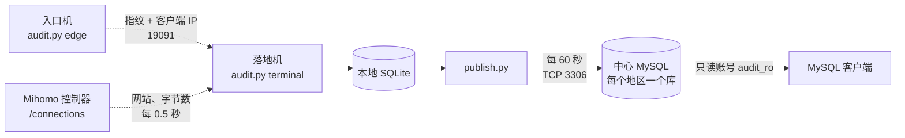

# VPS 流量审计

本项目用于记录代理线路的使用情况，包括客户端 IP、所经入口机、访问的网站以及产生的流量。审计结果写入 MySQL，使用者通过只读账号查询五个中文视图即可获取。

系统仅以旁路方式抓包，不参与转发，也不修改任何转发规则。审计程序异常退出时，代理业务不受影响，仅缺失该时段的记录。系统不保存抓包文件（PCAP），不解密流量，也不记录 Cookie 和网址路径。

## 背景

常见的代理线路结构如下：客户端连接入口机，入口机通过四层转发或隧道将流量送至落地机，落地机上的 Mihomo 解密后访问目标网站。


在落地机上，Mihomo 的连接列表可以提供访问的网站（如 `example.com`）和字节数，但来源地址是入口机或隧道的地址，无法得知客户端的真实 IP（如 `198.51.100.7`）。入口机的情况正好相反：它知道客户端 IP，但流量已加密，无法得知访问的网站。

因此，需要将两端的信息对应起来。

## 工作原理

同一条连接的加密数据由入口机原样转发至落地机。两端分别抓包，对该连接起始部分的密文计算 SHA-256，所得结果相同。本项目将该哈希值称为"指纹"，并以此完成两端的匹配。

以一条 TCP 连接为例，处理过程如下：

1. 客户端 `198.51.100.7` 连接入口机。入口机上的 `audit.py`（edge 模式）捕获该连接，取客户端发出的前 96 字节计算指纹，并将指纹与客户端 IP 一同发送至落地机。该消息附带 HMAC 签名，经 UDP 或 HTTP 传输，默认端口为 19091。
2. 该连接到达落地机后，落地机上的 `audit.py`（terminal 模式）同样捕获并计算出相同的指纹，然后在入口机发来的记录中查找。若仅找到一条匹配记录，则将该连接归属于 `198.51.100.7`；若未找到或找到多条，则记为"未识别"，不以入口机地址代替。
3. 落地机每 0.5 秒读取一次本机 Mihomo 控制器的 `/connections` 接口，获取该连接访问的网站（`metadata.host`）及累计字节数，以前后两次读数之差作为该时段的流量。
4. 结果先写入落地机本地的 SQLite。`central/publish.py` 每 60 秒将新增数据批量写入中心 MySQL，中心确认接收后，本地才删除待上传记录。因此网络中断恢复后，数据既不会丢失，也不会重复写入。

UDP 连接的处理方式相同，区别在于取客户端发出的前 3 个数据包计算指纹。



## 术语

| 术语 | 含义 |
|---|---|
| 入口机 | 客户端直接连接的机器，运行 `audit.py` 的 edge 模式 |
| 落地机 | 运行 Mihomo 并由此访问目标网站的机器，运行 `audit.py` 的 terminal 模式 |
| 中继 | 部分入口机无法直接连接落地机，其数据先发送至中继机，由 `central/edge_queue.py` 转发 |
| 中心库 | 汇总审计数据的 MySQL，每个地区对应一个数据库 |
| 指纹 | 连接起始部分密文的 SHA-256 值，入口机和落地机分别计算，用于匹配 |
| 未识别 | 指纹未匹配成功或匹配到多条记录的连接，不填写客户端 IP |
| 上传序号 / 确认位置 | 落地机为每条待上传数据分配的编号；中心已确认接收的最大序号称为确认位置（ACK），用于判断上传是否正常 |

## 查询数据

可使用任意 MySQL 客户端（如 Navicat、DBeaver 或 `mysql` 命令行）连接中心地址的 TCP 3306 端口，账号为 `audit_ro`。地址和密码由部署方另行提供。

```sql
SHOW DATABASES;      -- 列出可访问的地区数据库
USE `<地区库名>`;
SELECT * FROM `审计明细` LIMIT 50;
```

五个视图的内容如下：

| 视图 | 内容 |
|---|---|
| `审计明细` | 近期连接：时间、客户端 IP、入口机、网站、最近 5 秒的上传与下载速率 |
| `流量汇总` | 本月 1 日至今，按"客户端 IP + 入口机 + 网站"累计的流量 |
| `入口流量汇总` | 入口机网卡每分钟的流量及平均速率 |
| `访问记录` | 各连接的建立记录，以及客户端 IP 的认定依据 |
| `同步状态` | 各落地机最后一次上传的时间、确认位置及数据缺失情况 |

`审计明细` 的输出示例如下：

| 时间 | 源 IP | 隧道内网 IP（入口机器） | 目标网站 | 最近上传速率 | 最近下载速率 |
|---|---|---|---|---|---|
| 2026-11-12 10:15:05 | 198.51.100.7 | 203.0.113.10（入口A） | example.com | 12.30 KB/s | 1.21 MB/s |
| 2026-11-12 10:15:05 | 198.51.100.7 | 203.0.113.10（入口A） | cdn.example.net | 12.30 KB/s | 1.21 MB/s |

两行速率相同，是因为该速率为此客户端 IP 全部连接的合计值，而非单条连接的速率。因此，同一时刻的多行不应再相加。其他视图的计算方式见 [数据口径](docs/data.md)。

时间均为北京时间。最近 7 天的数据可直接查询，数据库内最多保留 14 天，更早的数据已打包存放至数据库外，常规查询不会返回。

### 在采集机器上查询

不连接中心库时，也可在入口机或落地机上使用自带的只读脚本查询。该脚本读取本机 SQLite，以 JSON 格式输出：

```bash
python3 query.py health
python3 query.py details --limit 20 --source-ip 198.51.100.7
python3 query.py summary --from 2026-11-01T00:00:00+08:00 --to 2026-11-12T00:00:00+08:00 --group-by site --limit 50
```

`--group-by` 的可选值为 `source_ip`、`site` 和 `node`。

## 部署

本项目不提供一键安装脚本，需按机器角色部署相应组件：

| 角色 | 运行程序 | 服务模板 | 主要配置项 |
|---|---|---|---|
| 入口机 | `audit.py`，`"mode": "edge"` | `deploy/traffic-audit-*-edge.service` | `captures`（抓包网卡与端口）、`endpoint`（落地机或中继地址）、`auth_file`（签名密钥） |
| 落地机 | `audit.py`，`"mode": "terminal"` | `deploy/traffic-audit.service` | `listen`、`captures`、`peers`（所属入口机）、`inbound_ports`、`mihomo_config` |
| 落地机 | `central/publish.py` | `central/traffic-audit-publish.service` | 私有文件 `writer.json`（中心地址与上传账号） |
| 中心 | `central/archive.py`、`central/prune.py`、`central/backup.sh` | 对应的 `.timer` | 归档目录、数据库连接 |

入口机的配置示例如下（取自 `config/` 目录，地址已替换）：

```json
{
  "mode": "edge",
  "node": "entry-a",
  "captures": [{"interface": "ens3", "tcp_ports": [3990], "udp_ports": [3990]}],
  "endpoint": "http://203.0.113.20:19091",
  "auth_file": "/etc/traffic-audit/identity.toml",
  "db": "/var/lib/traffic-audit/audit.sqlite",
  "health": "/var/lib/traffic-audit/health.json"
}
```

部署步骤：

1. 参照 `config/` 中同角色的示例编写配置，将主机名、地址和端口替换为实际值。编写完成后，执行 `python3 audit.py --config <配置文件> --check` 进行校验。
2. 将代码部署至 `/usr/local/libexec/traffic-audit/`，配置部署至 `/etc/traffic-audit/`，安装并启用对应的 systemd 服务。
3. 新地区的中心库使用 `central/region.py` 创建。
4. 上线后发起一条新连接，确认 `审计明细` 中能显示客户端 IP，且 `同步状态` 中的确认位置持续前进。

依赖方面，入口机和落地机需要 Python 3.11 及以上版本和 libpcap，落地机读取 Mihomo 配置时另需 PyYAML；`publish.py` 及中心组件需要 PyMySQL。抓包通过 `ctypes` 直接调用 libpcap，不依赖 scapy。

更新已运行的机器时，使用 `deploy/update.py` 仅打包改动的文件，先在单台机器上试运行，确认无误后再更新其他机器。详见 [发布工具](deploy/README.md) 与 [运维说明](docs/operations.md)。

## 本地检查

以下命令仅在本地执行，不连接服务器：

```powershell
python tools/check.py                                   # 检查文档链接、配置及视图列名
python tools/validate.py --business collector --changed audit.py --run   # 仅运行与改动相关的测试
python -m unittest discover -s tests -v                 # 运行全部测试
```

`--business` 的取值见 [分级校验](docs/validation.md)。

## 目录结构

| 路径 | 内容 |
|---|---|
| `audit.py` | 采集主程序，包括 edge 与 terminal 两种模式及指纹匹配 |
| `capture.py` | 调用 libpcap 抓包、跟踪连接、计算指纹 |
| `transport.py`、`edge_front.py` | 入口机至落地机的签名报文 |
| `rates.py`、`presentation.py`、`query.py` | 5 秒速率、本地视图、本地查询脚本 |
| `maintenance.py` | 本地 SQLite 的分批清理 |
| `central/` | 上传、中心建表、视图 SQL、月累计、归档、备份及定时器 |
| `config/` | 各机器的配置示例，不含密钥 |
| `deploy/` | systemd 模板、发布工具、历史迁移脚本 |
| `client/` | 只读连接检查 |
| `tests/`、`tools/` | 离线测试、约定检查、提交前的敏感信息扫描 |

## 相关文档

| 文档 | 内容 |
|---|---|
| [架构设计](design.md) | 各进程、端口、数据表及指纹匹配的细节 |
| [数据口径](docs/data.md) | 各视图中数值的计算方式 |
| [存储说明](docs/storage.md) | 表结构、数据保留期限及新增地区 |
| [数据库优化](docs/database-optimization.md) | 索引、预先汇总与归档 |
| [运维说明](docs/operations.md) | 发布、故障排查、归档与备份，以及禁止的操作 |
| [分级校验](docs/validation.md) | 按改动类型选择检查项 |
| [客户端连接](client/README.md) | 中心库的连接方式 |
| [发布工具](deploy/README.md) | 发布包的生成与审查 |

## 已知限制

- 统计结果只会低于实际值，不会高于实际值。抓包可能丢包，极短的连接及连接结束前的最后一部分流量可能未被记录，未匹配成功的连接也不计入任何客户名下。因此，统计结果不适用于计费。
- 历史上未识别的记录不会事后补录，也不会以入口机地址补填。
- `central/init.py`、`deploy/central.py`、`deploy/rename_db.py` 为一次性建库或迁移脚本，不应对已投入使用的数据库重复执行；`deploy/*.json` 中的历史发布请求也不应重新执行。
- 密钥、密码、私有连接文件、日志及验收记录均不纳入仓库。提交前请执行 `python tools/publish_check.py`，新增配置仍需人工审查。
