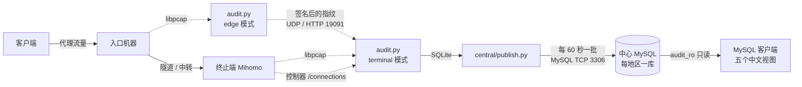

# VPS 流量审计

本项目是面向代理线路的流量审计工具。系统在入口机器和代理出口（下文称“终止端”）上抓包，确定每条连接来自哪个客户 IP、经由哪个入口、访问了哪个网站以及产生了多少流量，并将结果写入 MySQL。使用者通过只读账号查询五个中文视图即可获取审计数据。

本系统不承担代理功能，也不修改转发规则。所有采集均为旁路只读；审计程序异常退出时，代理业务不受影响，仅缺失对应时段的记录。系统不保存抓包文件（PCAP）、加密内容、Cookie 或网址路径。

## 运行原理



一条连接从建立到可被查询，依次经过以下四个阶段。

1. 入口生成指纹。入口机器上的 `audit.py`（edge 模式）通过 libpcap 捕获指定端口的客户端流量。TCP 连接取客户端发出的前 96 字节计算哈希，UDP 连接取前 3 个数据包计算哈希，该哈希称为连接的“指纹”。指纹与客户端 IP 一并签名后发送至终止端（默认端口 19091）。
2. 终止端匹配指纹。流量经中转后，终止端只能看到中转机地址，无法直接得知客户 IP。终止端的 `audit.py`（terminal 模式）对同一连接计算指纹，若与入口发来的指纹唯一匹配，则将该连接归属于对应的客户 IP；若无法匹配或匹配到多个结果，则记为“未识别”。网站名称和字节数取自本机 Mihomo 控制器的 `/connections` 接口，采样间隔为 0.5 秒。
3. 本地暂存与上传。采集结果首先写入本机 SQLite。`central/publish.py` 每 60 秒将新增数据打包，通过 PyMySQL 写入中心数据库。只有在中心确认接收后，本地才删除待上传记录，因此网络中断恢复后既不会重复写入，也不会遗漏。
4. 中心存储与查询。每个地区对应一个独立的数据库，表结构统一，按月流量累计由数据库自动维护。最近 7 天的数据可直接查询，数据库内最多保留 14 天；更早的数据经校验后按月打包迁出数据库，仅在需要时单独读取。

## 技术栈

| 层级 | 技术 |
|---|---|
| 语言 | Python 3.11+，以标准库为主；发布辅助脚本使用 Node.js |
| 抓包 | libpcap，通过 `ctypes` 直接调用并设置 BPF 过滤，不依赖 scapy |
| 网站信息来源 | Mihomo（Clash.Meta）控制器 REST API |
| 入口至终止端传输 | 自定义 UDP 报文（HMAC-SHA256 签名、zlib 压缩）或 HTTP 批量队列 |
| 节点本地存储 | SQLite（WAL 模式，设有容量上限并定期清理） |
| 中心数据库 | MySQL（InnoDB、触发器、视图），驱动为 PyMySQL |
| 运行环境 | Linux 与 systemd 服务及定时器，配有权限限制及内存、CPU 配额 |
| 客户端 | 任意 MySQL 客户端，TCP 3306，只读账号 `audit_ro` |
| 测试 | `unittest` 离线测试；连接真实 MySQL 的测试仅在独立测试库中运行 |

各机器仅需安装其角色所需的依赖：入口和终止端需要 Python 与 libpcap，终止端读取 Mihomo 配置另需 PyYAML；上传程序和中心组件需要 PyMySQL。

## 使用方法

### 查询审计数据

使用任意 MySQL 客户端连接中心地址（TCP 3306，账号 `audit_ro`，地址与密码由部署方提供），选择需要查询的地区数据库：

```sql
SHOW DATABASES;      -- 列出可访问的审计数据库
USE `<地区库名>`;
```

随后查询五个视图：

```sql
SELECT * FROM `审计明细` LIMIT 50;     -- 时间、客户 IP、入口、网站、最近 5 秒速率
SELECT * FROM `流量汇总` LIMIT 50;     -- 本月按客户 IP、入口、网站分组的累计流量
SELECT * FROM `入口流量汇总` LIMIT 50; -- 入口网卡流量及每分钟平均速率
SELECT * FROM `访问记录` LIMIT 50;     -- 访问记录及客户归属依据
SELECT * FROM `同步状态`;              -- 各采集点最后上传时间及积压情况
```

时间均为北京时间，速率和流量自动换算为 KB、MB 等单位。阅读结果时需注意两点：明细中的速率是该客户 IP 全部连接的合计速率，同一时刻的多行不应再次相加；流量汇总为当月累计，次月重新计算。完整说明见 [数据口径](docs/data.md)，连接方式见 [客户端连接](client/README.md)。

### 在采集机器上查询

采集机器自带只读命令行工具，直接读取本机 SQLite 并输出 JSON：

```bash
python3 query.py health
python3 query.py details --limit 20 --source-ip 203.0.113.5
python3 query.py summary --from 2026-11-01T00:00:00+08:00 --to 2026-11-12T00:00:00+08:00 --group-by site --limit 50
```

`--group-by` 的可选值为 `source_ip`（按客户）、`site`（按网站）和 `node`（按采集点）。

### 部署

本仓库不提供一键安装脚本，需按机器角色组合以下组件：

| 角色 | 程序与服务模板 | 主要配置项 |
|---|---|---|
| 入口探针 | `audit.py`（`mode: edge`），参考 `deploy/traffic-audit-*-edge.service` | `captures`（网卡与端口）、`endpoint`、`auth_file` |
| 终止端采集 | `audit.py`（`mode: terminal`），`deploy/traffic-audit.service` | `listen`、`captures`、`peers`、`inbound_ports`、`mihomo_config` |
| 上传 | `central/publish.py`，`central/traffic-audit-publish.service` | 私有文件 `writer.json`（中心地址与上传账号） |
| 中心维护 | `central/archive.py`、`central/prune.py`、`central/backup.sh` 及对应 `.timer` | 归档目录、数据库连接 |

部署步骤如下：

1. 参照 `config/` 中同角色的示例编写配置。示例中的主机名、地址和端口属于原部署环境，需替换为实际值。编写完成后先执行 `python3 audit.py --config <配置文件> --check` 进行校验。
2. 将代码部署至 `/usr/local/libexec/traffic-audit/`，配置部署至 `/etc/traffic-audit/`，安装并启用对应的 systemd 服务。
3. 新地区的中心数据库使用 `central/region.py` 创建。上线后确认 `同步状态` 中的确认位置持续前进，并确认新连接能够识别出客户 IP。

日常更新使用 `deploy/update.py` 生成仅包含改动文件的发布请求，经人工审查后先在单台机器上试运行，确认无误后再推广至其他机器。详见 [发布工具](deploy/README.md) 与 [运维说明](docs/operations.md)。

### 本地开发与检查

以下命令在仓库根目录执行，均不连接服务器：

```powershell
python tools/check.py                                   # 检查文档链接、配置及视图列名等约定
python tools/validate.py --business docs --run          # 按改动类型运行对应测试
python tools/validate.py --business collector --changed audit.py --run
python -m unittest discover -s tests -v                 # 全部测试
```

`--business` 的取值见 [分级校验](docs/validation.md)。

## 目录结构

| 路径 | 内容 |
|---|---|
| `audit.py` | 采集主程序：edge 与 terminal 两种模式、指纹匹配、健康状态文件 |
| `capture.py` | libpcap 抓包、连接跟踪、指纹计算 |
| `transport.py`、`edge_front.py` | 签名 UDP 报文、入口地址校验 |
| `rates.py`、`presentation.py`、`query.py` | 5 秒速率、本地展示视图、本地查询工具 |
| `maintenance.py` | 分批删除等本地维护功能 |
| `central/` | 上传、中心入库、建表、视图 SQL、月累计、归档、备份及定时器 |
| `config/` | 各节点配置示例，不含密钥 |
| `deploy/` | systemd 模板、发布请求生成器、历史迁移脚本 |
| `client/` | 只读连接检查 |
| `tests/`、`tools/` | 离线测试、约定检查、提交前敏感信息扫描 |

## 相关文档

| 文档 | 内容 |
|---|---|
| [架构设计](design.md) | 组件、进程、端口、数据表及指纹匹配方法 |
| [数据口径](docs/data.md) | 时间、速率、累计的计算方式及客户 IP 的识别规则 |
| [存储说明](docs/storage.md) | 表结构、数据分层及新增地区 |
| [数据库优化](docs/database-optimization.md) | 索引、预先汇总与归档 |
| [运维说明](docs/operations.md) | 发布、故障排查、归档与备份 |
| [分级校验](docs/validation.md) | 按改动类型选择检查项 |
| [客户端连接](client/README.md) | MySQL 只读连接与查询示例 |
| [发布工具](deploy/README.md) | 发布请求的生成与审查 |

## 已知限制

- 统计结果只会偏少，不会偏多。抓包可能丢包，极短的连接以及连接结束前的最后一部分流量可能未被记录，无法识别的客户显示为“未识别”。因此统计结果不可用于计费。
- 系统不会将中转机地址记为客户 IP，历史上未识别的记录也不会事后补录。
- `central/init.py`、`deploy/central.py`、`deploy/rename_db.py` 等为一次性建库或迁移脚本，不得对已投入使用的数据库重复执行；`deploy/*.json` 中的历史发布请求也不得重新执行。
- 私钥、密码、私有连接文件、日志和验收记录均不纳入仓库。提交前执行 `python tools/publish_check.py` 扫描待提交文件；新增配置仍需人工审查。
