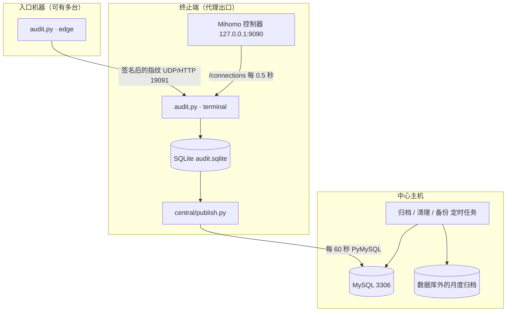

# 架构设计

系统分为三层，各司其职：入口负责识别连接来自哪个客户，终止端负责记录访问的网站和产生的流量，中心负责汇总与查询。三层均为旁路观测，不解密代理内容，也不修改转发规则。

## 部署结构

每个地区设有一个或多个终止端，每个终止端配有各自的入口探针。部分入口无法直接连接终止端，此时由中间主机上的 `central/edge_queue.py` 进行中继：入口通过 HTTP 发送数据，中继端先行存储再转发。中心 MySQL 按地区分库。同一数据库中存在多个采集点时，各采集点使用独立前缀的数据表和独立的上传账号，彼此隔离。

## 运行进程

| 程序 | 运行位置 | 职责 | systemd 模板 |
|---|---|---|---|
| `audit.py`（edge） | 入口机器 | 捕获客户端流量，计算并签名发送指纹，统计入口网卡流量 | `deploy/traffic-audit-*-edge.service` |
| `audit.py`（terminal） | 终止端 | 接收指纹，捕获本机代理端口流量，读取 Mihomo 数据，完成匹配后写入 SQLite | `deploy/traffic-audit.service` |
| `central/publish.py` | 终止端 | 将 SQLite 中的新增数据分批写入中心 MySQL | `central/traffic-audit-publish.service` |
| `central/edge_queue.py` | 中继主机 | 为无法直连的入口中继转发数据（分为 sender 与 receiver 两端） | `deploy/traffic-audit-*-receive.service` |
| `central/archive.py` | 中心 | 每 5 分钟运行一次，将超过 14 天的数据打包迁出数据库 | `central/traffic-central-archive.timer` |
| `central/prune.py` | 中心 | 清理过期数据 | `central/traffic-central-prune.timer` |
| `central/backup.sh` | 中心 | 每日备份 | `central/traffic-central-backup.timer` |

采集服务均通过 systemd 进行权限限制：仅授予抓包所需的 `CAP_NET_RAW` 和 `CAP_NET_ADMIN`，系统目录只读，仅允许写入 `/var/lib/traffic-audit`，并设有内存和 CPU 上限。程序异常退出只会造成审计记录缺失，不影响代理业务。

## 端口与安全

| 端口 | 方向 | 说明 |
|---|---|---|
| 19091 UDP/TCP | 入口 → 终止端 | 传输指纹。报文格式为 `TA1 \| 节点名 \| HMAC-SHA256 签名 \| zlib 压缩的 JSON`。接收方先验证签名再解压；发送方收到对应确认后才删除本地待发数据 |
| 9090（仅本机） | 终止端本机 | Mihomo 控制器，仅读取 `/connections` |
| 3306 TCP | 上传程序及客户端 → 中心 | 上传账号仅能从指定 IP 写入指定的库或表；`audit_ro` 仅能读取审计表和视图 |

签名密钥无需单独分发。组网配置中已有共享密钥，各节点以该密钥和自身节点名派生出专用密钥（`HMAC(secret, "traffic-audit/v1/<node>")`）。传输过程只签名、不加密。指纹仅为加密数据前若干字节的哈希值，无法从中还原任何内容。

## 客户 IP 的识别方法

终止端看到的对端地址是中转机，而非客户。由于同一连接的加密数据在入口和终止端完全相同，两端计算出的指纹也相同，系统据此完成匹配。

1. 区分连接。`capture.py` 按五元组（协议及两端 IP 和端口）跟踪连接。同一五元组出现新的 SYN 时视为新连接。抓包开始前已建立的 TCP 连接没有 SYN，单独标记。
2. 计算指纹。TCP 按序号重组客户端发出的数据（处理乱序、重传和序号回绕），取前 96 字节计算哈希；UDP 取客户端前 3 个完整的非空数据包。遇到数据缺失、内容冲突或 IP 分片时，不计算指纹。
3. 匹配。入口发来的指纹附带客户 IP。终止端在一定时间窗口内找到唯一相同的指纹时，将该连接归属于对应的客户 IP 和入口；找到多个或未找到时，均记为“未识别”。
4. 网站与流量。终止端根据对端端口和本机代理端口，将抓包得到的连接与 Mihomo 中的连接对应起来。网站取 `metadata.host`，缺失时使用目标 IP。Mihomo 提供的是每条连接的累计字节数，系统每 0.5 秒读取一次，以前后两次之差作为该时段的流量。

若某个代理端口仅供一个入口使用，可在配置中明确声明。该声明仅用于确定入口，客户 IP 仍须通过指纹识别。

## 数据表

采集机器的 SQLite 与中心 MySQL 使用同一组数据表（定义见 `central/model.py`）：

| 表 | 内容 |
|---|---|
| `connection_state` | 每条代理连接：开始时间与最后活动时间、中转机地址、识别出的客户 IP、入口、网站 |
| `samples` | 每 0.5 秒的上传、下载字节数 |
| `connection_rates` | 各连接的速率 |
| `visits` | 访问记录及客户归属依据 |
| `wire_samples` | 入口网卡每分钟的字节数和包数 |
| `entry_routes`、`peers` | 代理端口与入口的对应关系、入口探针心跳 |

采集机器上另有 `flows`、`fingerprints`、`spool` 等处理过程中使用的表，以及上传程序使用的 `central_meta` 和 `central_dirty`（待上传清单）。中心各数据库还包含以下表：

- `traffic_monthly`：按月流量累计，由触发器在写入时自动更新。
- `traffic_calendar`、`archive_receipts`：记录已归档的数据。
- `audit_schema`：表结构版本号。
- `sync_state`：各采集点的上传进度。

对外仅提供五个中文视图：`审计明细`、`流量汇总`、`入口流量汇总`、`访问记录`、`同步状态`。

## 上传的可靠性

- SQLite 每写入一条数据，即将其主键记入待上传清单 `central_dirty`。该清单保存在磁盘上，程序重启后不会丢失。
- 上传程序每 60 秒从清单中取出一批数据写入 MySQL。写入采用“存在则更新、不存在则插入”的方式，同一批数据重复写入不会产生重复记录。中心确认后，才从清单中删除对应条目。积压较多时，同一轮内连续上传完毕，期间新产生的数据留待下一轮处理。
- 每个采集点拥有独立的上传身份、批次编号（epoch）和序号，互不影响。`同步状态` 视图展示最后上传时间、已确认的序号及缺失数量。超过 90 秒未上传即视为滞后。
- 采集机器仅保留约 24 小时已上传的数据作为缓冲，完整历史以中心数据库为准。

## 数据分层

| 分层 | 默认范围 | 读取方式 |
|---|---|---|
| 热数据 | 最近 7 天 | 五个中文视图默认查询此范围 |
| 温数据 | 7 天之前、14 天之内 | 查询时指定时间范围，或直接查询原始表 |
| 冷数据 | 14 天之前 | 按北京时间月份打包存放于数据库外，仅在明确需要时读取 |

热数据与温数据存放在同一张表中，通过时间索引区分，不重复存储。归档流程为：先生成归档文件并核对行数和校验和，再在同一数据库事务中保存当月累计、写入归档记录并删除库内旧数据。任一步骤失败，库内数据均保持不变。月累计不受 14 天保留期限制，始终覆盖整月。详见 [存储说明](docs/storage.md)。

## 功能与代码对照

| 功能 | 代码 |
|---|---|
| 抓包与指纹计算 | `capture.py` |
| 采集主程序与指纹匹配 | `audit.py`、`edge_front.py` |
| 入口至终止端的传输 | `transport.py`、`central/edge_queue.py` |
| 速率与本地展示 | `rates.py`、`presentation.py`、`query.py` |
| 上传与中心入库 | `central/publish.py`、`central/receive.py`、`central/model.py` |
| 建表与中心查询 | `central/region.py`、`central/storage.py`、`central/views.sql`、`central/query.py`、`central/hk_query.py` |
| 月累计与归档 | `central/monthbook.py`、`central/tiering.py`、`central/archive.py` |

## 设计约束

- 不保存抓包文件及任何传输内容。每条 TCP 连接最多在内存中暂存 96 字节加密数据用于计算哈希，计算完成后即丢弃。
- 入口网卡流量按 IP 包总长度计算，包含包头和重传；网站流量为 Mihomo 记录的实际内容字节数。两者统计口径不同，不可相加。
- `审计明细` 视图会将 5 秒内的重复行合并显示，底层的连接、访问和流量记录不做合并。
- 新增采集点前，须先确定其表前缀、上传身份和写入权限，避免与现有采集点的数据冲突。

各项指标的计算方式见 [数据口径](docs/data.md)，部署要求见 [运维说明](docs/operations.md)。
