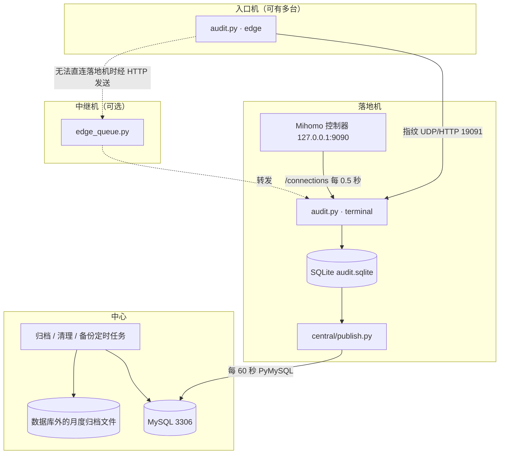

# 架构设计

本文介绍各机器上运行的程序、程序之间的通信方式以及数据表结构。术语含义见 [README](README.md#术语)。

系统由三部分组成：入口机负责确定客户端身份，落地机负责记录访问的网站和流量，中心库负责汇总与查询。三部分均只进行抓包和接口读取，不解密流量，也不修改转发规则。

## 部署结构

每个地区设有一台或多台落地机，每台落地机对应若干入口机。部分入口机无法直接连接落地机，此时由入口机通过 HTTP 将数据发送至中继机上的 `central/edge_queue.py`，中继机先行存储，再转发至落地机。

中心库按地区分库。同一数据库中存在多台落地机时，每台落地机使用一套带独立前缀的数据表（例如 `a_samples`、`b_samples`）和独立的上传账号，彼此隔离。

## 运行进程

| 程序 | 运行位置 | 职责 | systemd 模板 |
|---|---|---|---|
| `audit.py`（edge） | 入口机 | 捕获客户端流量，计算指纹并签名发送至落地机，同时统计入口网卡流量 | `deploy/traffic-audit-*-edge.service` |
| `audit.py`（terminal） | 落地机 | 接收指纹，捕获本机代理端口流量，读取 Mihomo 数据，完成匹配后写入 SQLite | `deploy/traffic-audit.service` |
| `central/publish.py` | 落地机 | 将 SQLite 中的新增数据分批写入中心库 | `central/traffic-audit-publish.service` |
| `central/edge_queue.py` | 中继机 | 为无法直连落地机的入口机转发数据，分为 sender 与 receiver 两端 | `deploy/traffic-audit-*-receive.service` |
| `central/archive.py` | 中心 | 每 5 分钟运行一次，将超过 14 天的数据打包迁出数据库 | `central/traffic-central-archive.timer` |
| `central/prune.py` | 中心 | 清理过期数据 | `central/traffic-central-prune.timer` |
| `central/backup.sh` | 中心 | 每日备份 | `central/traffic-central-backup.timer` |

采集服务通过 systemd 进行权限限制：仅授予抓包所需的 `CAP_NET_RAW` 和 `CAP_NET_ADMIN`，系统目录只读，仅允许写入 `/var/lib/traffic-audit`，并设置内存与 CPU 上限。

## 端口

| 端口 | 方向 | 说明 |
|---|---|---|
| 19091 UDP/TCP | 入口机 → 落地机 | 传输指纹。入口机收到落地机的确认后，才删除本地待发数据 |
| 9090（仅监听本机） | 落地机本机 | Mihomo 控制器，仅读取 `/connections` |
| 3306 TCP | `publish.py` 及查询客户端 → 中心 | 上传账号仅能从指定 IP 写入指定的库或表；`audit_ro` 仅具有只读权限 |

19091 端口上的报文格式为 `TA1 | 节点名 | HMAC-SHA256 签名 | zlib 压缩的 JSON`。落地机先验证签名，再进行解压。

签名密钥无需单独分发。组网（EasyTier）配置中已有共享密钥，各机器以该密钥和自身节点名派生出专用密钥：`HMAC(共享密钥, "traffic-audit/v1/<节点名>")`。报文仅签名、不加密。指纹是密文的哈希值，无法据此还原任何内容；客户端 IP 在该链路上以明文传输。

## 指纹匹配

落地机看到的来源地址是入口机或隧道的地址。由于同一连接的密文在两端完全相同，两端计算出的指纹也相同，系统据此完成匹配。

1. 区分连接。`capture.py` 按五元组（协议及两端 IP 和端口）跟踪连接，同一五元组出现新的 SYN 时视为新连接。抓包开始前已建立的 TCP 连接没有 SYN，单独标记。
2. 计算指纹。TCP 按序号重组客户端发出的数据（处理乱序、重传和序号回绕），取前 96 字节计算 SHA-256；UDP 取客户端发出的前 3 个非空数据包。遇到数据缺失、重传内容不一致或 IP 分片时，不计算指纹。
3. 匹配。入口机发来的每个指纹均附带客户端 IP。落地机在一定时间窗口内仅找到一个相同指纹时，才将该连接归属于对应的客户端 IP 和入口机；未找到或找到多个时，均记为未识别。
4. 网站与流量。落地机根据对端端口和本机代理端口，将抓包得到的连接与 Mihomo 中的连接对应起来。网站取 `metadata.host`，缺失时使用目标 IP。Mihomo 提供的是每条连接的累计字节数，系统每 0.5 秒读取一次，以前后两次之差作为该时段的流量。

若某个代理端口仅供一台入口机使用，可在配置中声明。该声明仅用于确定入口机，客户端 IP 仍须通过指纹匹配得出。

采集器重启前已建立的长连接缺少起始密文，无法按上述方法计算指纹。启用配置项 `tcp_stream_recovery` 后，系统改用连接中段按序号对齐的 32 字节密文块（以方向、序号和内容共同计算哈希）进行匹配，每条连接每 10 秒最多发送 3 个。该配置项默认关闭。

## 数据表

落地机的 SQLite 与中心 MySQL 使用同一组数据表，定义见 `central/model.py`：

| 表 | 内容 |
|---|---|
| `connection_state` | 每条代理连接：开始时间、最后活动时间、入口机或隧道地址、识别出的客户端 IP、入口机、网站 |
| `samples` | 每 0.5 秒的上传、下载字节数 |
| `connection_rates` | 各连接的速率 |
| `visits` | 访问记录及客户端 IP 的认定依据 |
| `wire_samples` | 入口机网卡每分钟的字节数和包数 |
| `entry_routes`、`peers` | 代理端口与入口机的对应关系、入口机心跳 |

落地机上另有 `flows`、`fingerprints`、`spool` 等处理过程中使用的表，以及上传程序使用的 `central_meta` 和 `central_dirty`（待上传清单）。

中心各数据库还包含以下表：

| 表 | 内容 |
|---|---|
| `traffic_monthly` | 按月累计的流量，写入数据时由触发器自动更新 |
| `traffic_calendar`、`archive_receipts` | 已迁出数据库部分的月累计，以及各归档文件的记录 |
| `audit_schema` | 表结构版本号 |
| `sync_state` | 各落地机的上传进度 |

查询时仅使用五个中文视图：`审计明细`、`流量汇总`、`入口流量汇总`、`访问记录`、`同步状态`。

## 上传的可靠性

- 落地机每向 SQLite 写入一条数据，即将其主键记入待上传清单 `central_dirty`。该清单保存在磁盘上，进程重启后不会丢失。
- `publish.py` 每 60 秒从清单中取出一批数据写入 MySQL。写入采用"存在则更新、不存在则插入"（upsert）的方式，同一批数据重复写入也不会产生重复记录。中心提交成功后，才从清单中删除对应条目。
- 积压较多时，同一轮内连续上传完毕；上传期间新产生的数据留待下一轮处理。
- 每台落地机拥有独立的上传账号、批次编号（epoch）和序号。`同步状态` 视图展示最后上传时间、已确认的序号及缺失行数。超过 90 秒未上传即视为滞后。
- 落地机仅保留约 24 小时已上传的数据作为缓冲，完整历史以中心库为准。

## 数据保留期限

| 时间范围 | 读取方式 |
|---|---|
| 最近 7 天 | 五个视图默认查询此范围 |
| 7 天至 14 天 | 查询时指定时间范围，或直接查询原始表 |
| 14 天以前 | 已按北京时间月份打包存放于数据库外，需要时单独读取 |

前两段数据存放在同一张表中，仅按时间区分，不重复存储。

归档流程为：先生成归档文件，核对行数和校验和；核对通过后，在同一数据库事务中写入当月累计、写入归档记录并删除库内旧数据。任一步骤失败，库内数据均保持不变。月累计不受 14 天保留期的限制，始终覆盖整月。详见 [存储说明](docs/storage.md)。

## 功能与代码对照

| 功能 | 代码 |
|---|---|
| 抓包与指纹计算 | `capture.py` |
| 采集主程序与指纹匹配 | `audit.py`、`edge_front.py` |
| 入口机至落地机的传输 | `transport.py`、`central/edge_queue.py` |
| 速率与本地查询 | `rates.py`、`presentation.py`、`query.py` |
| 上传与中心入库 | `central/publish.py`、`central/receive.py`、`central/model.py` |
| 建表与中心查询 | `central/region.py`、`central/storage.py`、`central/views.sql`、`central/query.py`、`central/hk_query.py` |
| 月累计与归档 | `central/monthbook.py`、`central/tiering.py`、`central/archive.py` |

## 设计约定

- 不保存抓包文件及任何传输内容。每条 TCP 连接最多在内存中暂存 96 字节密文，计算指纹后即丢弃。
- 入口机网卡流量按 IP 包总长度计算，包含包头和重传；网站流量为 Mihomo 记录的内容字节数。两者计算方式不同，不可相加。
- `审计明细` 将 5 秒内的重复行合并显示，底层的连接、访问和流量记录不做合并。
- 新增落地机前，应先确定其表前缀、上传账号和写入权限，避免与现有落地机的数据冲突。

各项数值的计算方式见 [数据口径](docs/data.md)，部署要求见 [运维说明](docs/operations.md)。
